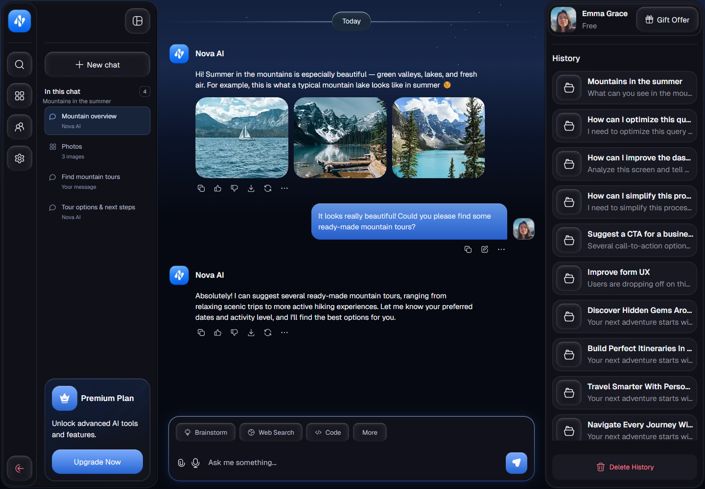

# Nova AI

A chat interface and reusable design system derived from the supplied Nova AI reference. The chat lives at `/`; the interactive design system lives at `/design-system`. A stateless seeded API supplies the profile, conversation data and illustrative replies.

**Original UI design:** [Sheikh Raihan UI](https://dribbble.com/sheikhraihan1) — [AI Travel Assistant Chatbot Dashboard UI](https://dribbble.com/shots/27840684-AI-Travel-Assistant-Chatbot-Dashboard-UI) on Dribbble. This repository recreates and adapts that visual design; the frontend implementation and interactions are separate contributions. No affiliation or endorsement is claimed.

Attribution and asset provenance are available on the app's `/credits` page and in [CREDITS.md](CREDITS.md).

## Chat UI preview

Screenshot of the current desktop implementation, showing the conversation outline, chat, message composer and history panel.



## Run locally

```sh
npm install
npm run dev
```

Open http://localhost:3000. For a production preview, run `npm run build`, then `npm start`.

## Included

- Semantic tokens covering color, typography, gradients, shadows, spacing, radii, sizes, layout, motion, both measured buttons, the composer, date badge and divider, profile/history sidebar, premium card, and glass dialogs.
- Fresh React primitives, rounded line icons, and composed chat, history, and premium patterns.
- Interactive examples, copyable colors and icons, searchable documentation, and JSON token export.
- Responsive documentation, keyboard controls, visible focus, reduced motion, and local Geist fonts.

Chat presentation lives in `components/chat/`; state, API code and layout styles live in `chat/`. The page and panels keep their 2px framing. The desktop icon rail stays fixed while the adjacent chat outline collapses with a 280ms animation. The panels and conversation form one workspace that fills standard desktop screens and is capped at 1920px on extra-wide monitors, keeping its panels together. Below 1250px history becomes a right-side drawer. Below 1100px, the chat uses the full available width and a Navigation button opens the complete action rail and current chat outline together from the left. Only one drawer is active at a time, with focus trapping, inert background controls, Escape/backdrop/swipe dismissal and focus restoration. Changing breakpoints closes stale drawers. Deleted history remains recoverable from the empty panel after the brief Undo notification disappears. Reduced-motion preferences disable sliding.

The left panel is **In this chat**: an outline derived from the current conversation's messages and photo groups. It follows the visible message as you scroll and jumps to the chosen content without changing conversations. The right History panel contains all saved chats, including travel examples previously shown only on the left. Empty chats explain how the outline is built; uncached switches show an outline skeleton. New messages, replies, edits and regeneration update the outline. The logo returns to the start of the current chat.

The adaptive header shows the current conversation and provides quick New chat and history controls. Conversation content follows the available workspace width. Compact drawers use 14px titles/list text, 12–13px supporting text and smaller visual tiles, while primary tap areas remain at least 44px. The action rail keeps its existing size. Phones get a scrollable mode row with More always accessible, a full-width 16px message field, 44px touch targets, horizontally browsable photos and secondary message actions under More. Jump to latest returns to the end of a long conversation. Short landscape screens compact navigation; visual-viewport sizing and safe-area insets keep controls within the visible screen. The three mountain photographs are exact crops from the supplied UI reference, stored in `public/images/`.

Visual foundations live in `design-system/`; reusable UI lives in `components/`. Documentation demos are separated from product controls; unused starter assets and old button prototypes have been removed. See [the system guide](design-system/README.md) for component usage and [the architecture guide](docs/architecture.md) for data flow, API contracts, ownership and backend migration.

The shared Nova logo is the supplied **Glossy Blue N Monogram App Icon**, preserved at `public/brand/Glossy Blue N Monogram App Icon.png`. `AppLogo` uses this asset across the UI; app, favicon, and touch icons derive from it.

Reusable controls live in `components/ui/`, chat presentation in `components/chat/`, and documentation UI in `components/design-system/`. Component filenames and exports describe their function, such as `message-composer.tsx` / `MessageComposer` and `conversation-history-panel.tsx` / `ConversationHistoryPanel`. `AppLogo` reads product identity from `config/app-brand.ts`.

`design-system/` owns visual tokens, example data, documentation and documentation styles; it does not own React component implementations. The root layout imports `design-system/tokens.css` and `components/ui/styles.css` directly. The `/design-system` page uses those same components and adds its own documentation styles.

The application pages are `/`, `/design-system`, and `/credits`. The design system includes all 24 interface icons as a simple icon-and-name gallery; clicking an item copies its usage. Comparison crops and the separate review demos have been removed. Seed API endpoints remain available for the chat.

The browser loads data through `chat/chat-api.ts`; fixtures stay server-only in `chat/server/`. API routes return consistent typed envelopes and simulate a random 1, 2 or 3 second response delay. Startup, uncached conversation changes and replies have skeleton loading states, cancellation and recoverable errors. Set `NOVA_DEMO_DELAY=false` in `.env.local` and restart to disable artificial latency.

Search, new conversations, editing, copy/download, feedback, history deletion with Undo, settings and both side panels work. New chats and edits belong to the current mounted tab and reset on refresh; the API does not persist them or share visitor state. AI responses, persistent storage, file uploads, account sessions and billing are not connected. The composer retains its attachment and browser voice-input behavior. Future backend work can replace the seed source and add persisted mutations through the existing API client and state hook without rebuilding the presentation.

## Design credits and reuse

Credit acknowledges the original designer; it does not establish permission to reuse the design or its assets. No reuse license or permission record for the reference design, screenshot, extracted photos/portrait, or separately supplied logo is documented in this repository. Confirm the applicable licenses or obtain permission from the relevant rights holders before redistribution or commercial reuse. A demo or educational purpose alone does not establish permission. See [Dribbble's terms](https://dribbble.com/terms).

The photograph and portrait crops remain reference-derived assets; their underlying creators have not been identified. The custom SVG implementation does not transfer ownership of the reference design. These notes do not relicense third-party work or guarantee legal clearance.

Geist Sans and Geist Mono are credited to The Geist Project Authors / Vercel under SIL OFL 1.1; the full notice is retained at [public/licenses/geist-OFL.txt](public/licenses/geist-OFL.txt). See [CREDITS.md](CREDITS.md) for the file-level provenance list. If permission is obtained or an asset is replaced, update both the credits page and that record.

## Verify

```sh
npm run lint
npm run build
```

With the app running, run `npm run test:api` to check HTTP contracts and seed isolation. Set `API_TEST_URL` to target a different local preview. These tests use Node's built-in runner and need no additional dependencies.

Built with Next.js 16 and React 19. Read the installed Next.js guides under `node_modules/next/dist/docs/` before changing application code, as required by `AGENTS.md`.
